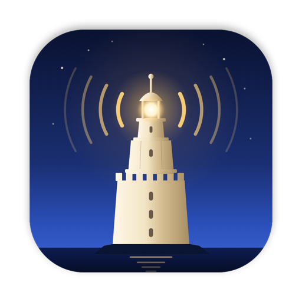
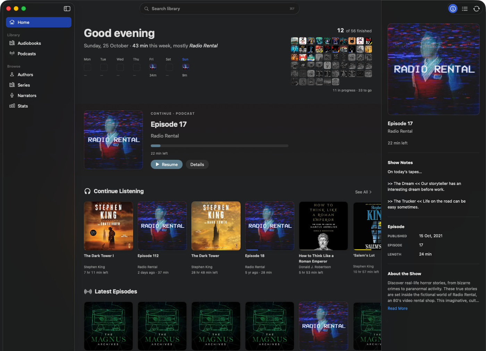
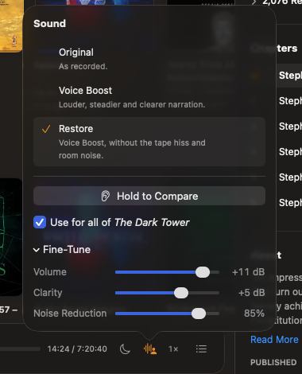
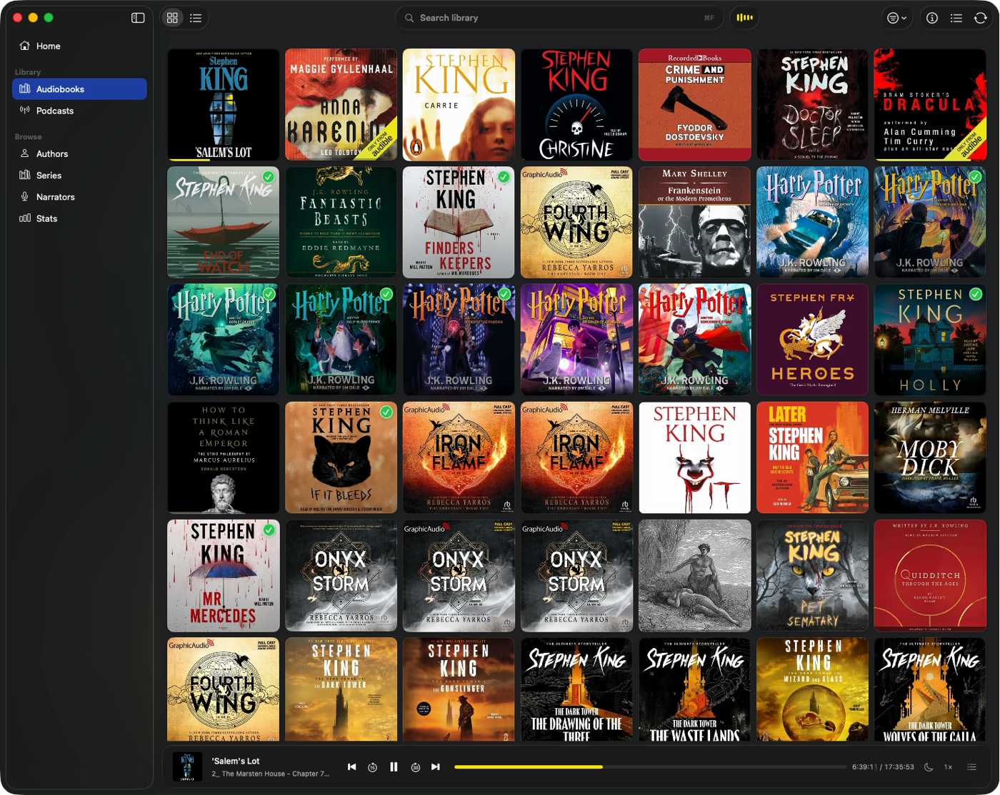

<div align="center">
  
  <h1>Alexandria</h1>
  <p><strong>A beautiful, native macOS client for your <a href="https://www.audiobookshelf.org/">audiobookshelf</a> library.</strong></p>
  <p>
    
    
    
  </p>
</div>

<br/>

<div align="center">
  
</div>

## Why Alexandria?

Every audiobookshelf client is iOS-first — Alexandria is built for the Mac. A real
SwiftUI app for books and podcasts alike, with a personal Home, gapless multi-track
playback, an editable Up Next, offline downloads, and deep system integration, designed
to feel like it shipped with macOS.

## Sound for old narrations



Older recordings — think the classic *Dark Tower* narrations — are often quiet, muffled,
and full of tape hiss. **Sound** fixes that while you listen:

- **Voice Boost** makes narration louder, steadier, and clearer.
- **Restore** adds Apple's on-device voice isolation to strip tape hiss and room noise.
- **Hold to Compare** to hear the original, and **fine-tune** volume, clarity, and noise
  reduction.
- Set it once for a book, or for **its whole series**; it's remembered and works offline
  too.

Everything runs on your Mac with Apple's own audio units. Nothing is uploaded.

<br clear="right"/>

## Features

- **Sound** — Voice Boost and Restore for quiet, hissy recordings, per book or series
  (see above).
- **Personal Home** — a seven-day **listening diary** (the covers of what you played
  each day, here and in your other audiobookshelf apps), your **library as a cover
  mosaic**, one-tap **Continue** for books and episodes from every library, and shelves
  for *Continue Listening*, *Latest Episodes*, *Discover*, *Listen Again*, and
  *Recently Added*.
- **Podcasts** — episode lists in the style of Apple Podcasts, newest- or oldest-first
  per show, played state, and per-episode downloads.
- **Up Next** — continues a show episode by episode or a series book by book; add with
  Play Next / Play Later or drag covers in, reorder, and it's saved per server.
- **Gapless playback** — multi-track books via `AVQueuePlayer` with chapters,
  ±15/30s skip, 0.75–3× speed, and a **sleep timer** that knows the end of the chapter,
  episode, or book.
- **Now Playing inspector** — details, chapters, and opt-in ratings and reviews from
  Audible and Open Library, spoilers collapsed.
- **Controls everywhere** — media keys & Now Playing (with artwork), a **menu-bar
  mini-player**, spacebar play/pause, and a live audio visualizer in the toolbar.
- **Offline** — download books and episodes; progress queues locally and syncs when
  you reconnect.
- **In step with your server** — progress, finished state, and listening sessions go
  back to audiobookshelf, so its stats and your other apps see Alexandria's listening.
- **Fast search** — a results dropdown with keyboard navigation and quick-play,
  focusable from anywhere with **⌘F**.
- **Browse & stats** — Authors, Series (in reading order), Narrators, a library
  grid/table with sort & filter, and a Stats dashboard.
- **Multi-server**, in-app updates (Sparkle), and Reduce-Motion-aware animation
  throughout.

## Screenshots

| Home | Library |
| :--: | :--: |
|  |  |

## Install

### Download (easiest)

1. Grab the latest **`Alexandria-x.y.z.dmg`** from **[Releases »](https://github.com/ahamedzoha/alexandria/releases/latest)**.
2. Open the DMG and drag **Alexandria** into **Applications**.
3. First launch (the build is free and **unsigned**, so Gatekeeper warns once):
   **right-click the app → Open → Open**. Or, in Terminal:
   ```bash
   xattr -dr com.apple.quarantine /Applications/Alexandria.app
   ```
4. Enter your server URL, username, and password.

Requires **macOS 26 (Tahoe) or later**.

### Build from source

- **Xcode 26 or later** — the UI adopts macOS 26 *Liquid Glass* APIs
  unconditionally, so both building and running require macOS 26.
- Open `Alexandria.xcodeproj`, pick scheme **Alexandria** / destination **My Mac**,
  press **⌘R**.

New `.swift` files dropped into `Alexandria/` are picked up automatically (Xcode
synchronized folders — no project fiddling).

## Releasing

Bump the version (target → General → Version), then tag it:

```bash
git tag v0.2.0 && git push origin v0.2.0
```

A GitHub Action builds the DMG and publishes the release with generated notes. The full
flow — versioning, the unsigned-install caveat, and the later Developer ID +
notarization path — lives in **[DISTRIBUTING.md](DISTRIBUTING.md)**.

## Tech

SwiftUI · Observation · AVFoundation (`AVQueuePlayer`, chapters) · MediaPlayer
(Now Playing / remote commands) · `async`/`await` REST against the audiobookshelf API.
macOS 26 deployment target; Liquid Glass adopted throughout.

## Roadmap

- [ ] Handoff
- [ ] Per-track download progress
- [ ] Keychain token storage (needs a signing team)
- [ ] Signed & notarized releases

## Press kit

Logo and screenshots for write-ups live in **[`press-kit/`](press-kit/)**.

---

<sub>Not affiliated with the audiobookshelf project. Built by
<a href="https://github.com/ahamedzoha">@ahamedzoha</a>.</sub>
